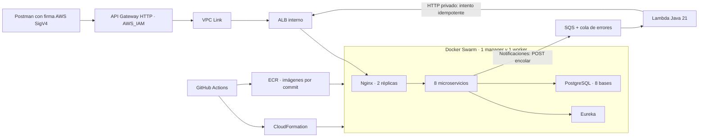

# FoodGo — despliegue EP03

JVY0101 · Jhohan Ramírez y Alex Llanten. Implementación académica de ocho dominios de delivery en Spring Boot, Java 21 y PostgreSQL.

Este repositorio coordina infraestructura, despliegue y evidencia de EP03. El [diseño original de EP01](docs/EP01-Diseno-original.md) se conserva como antecedente; sus propuestas de Cognito, Saga y EventBridge no describen funcionalidades implementadas en esta entrega.

## Repositorios

| Dominio | Código | Relación JPA |
|---|---|---|
| Usuarios | [foodgo-ms-usuarios](https://github.com/jhoramirez-afk/foodgo-ms-usuarios) | Usuario → Dirección |
| Restaurantes | [foodgo-ms-restaurantes](https://github.com/jhoramirez-afk/foodgo-ms-restaurantes) | Restaurante → ItemMenu |
| Pedidos | [foodgo-ms-pedidos](https://github.com/jhoramirez-afk/foodgo-ms-pedidos) | Pedido → DetallePedido |
| Pagos | [foodgo-ms-pagos](https://github.com/jhoramirez-afk/foodgo-ms-pagos) | Pago → TransaccionPago |
| Delivery | [foodgo-ms-delivery](https://github.com/jhoramirez-afk/foodgo-ms-delivery) | Envio → EventoTracking |
| Notificaciones | [foodgo-ms-notificaciones](https://github.com/jhoramirez-afk/foodgo-ms-notificaciones) | Notificacion → IntentoEnvio |
| Cupones | [foodgo-ms-cupones](https://github.com/jhoramirez-afk/foodgo-ms-cupones) | Cupon → UsoCupon |
| Reseñas | [foodgo-ms-resenas](https://github.com/jhoramirez-afk/foodgo-ms-resenas) | Resena → RespuestaResena |
| Registro | [foodgo-eureka-server](https://github.com/AlexanderLlanten/foodgo-eureka-server) | Catálogo de instancias |

## Componentes EP03



- Los Dockerfiles ejecutan `mvn clean verify` en una etapa Maven y copian el JAR a Java 21 con usuario sin privilegios.
- [docker-stack.yml](docker-stack.yml) usa imágenes construidas, actualización y rollback, límites de recursos, red overlay cifrada, secretos y volumen. Los Compose de cada servicio se conservan para la demostración local.
- [CloudFormation](infra/aws/) aprovisiona dos EC2, grupos de seguridad, ECR, ALB interno, VPC Link y API Gateway. Reutiliza `LabInstanceProfile` y `LabRole`; no crea roles IAM.
- [Mensajería](infra/aws/mensajeria.yaml): SQS, DLQ y Lambda Java 21. Notificaciones publica identificadores; Lambda registra el resultado de una **simulación académica**. No envía correos/SMS ni realiza cobros reales.
- [CI](.github/workflows/ci.yml) valida cambios sin AWS. [CD](.github/workflows/cloud.yml) construye los nueve proyectos y despliega desde este repositorio después de habilitarlo expresamente.

## Ejecución y evidencia

1. [Despliegue AWS Academy](docs/EP03-Despliegue-AWS.md): requisitos, revisión, variables y comandos.
2. [Pruebas y presentación](docs/EP03-Pruebas-y-presentacion.md): matriz de indicadores y demostración.
3. [Operación Swarm](swarm/README.md): comandos en el manager.
4. [Contrato Lambda](functions/notificaciones/README.md): payload, reintentos y lotes parciales.

Desde esta raíz, con Java 21, Maven, Python 3.12 y Docker, sin crear recursos AWS:

```bash
python -m pip install -r scripts/requirements-aws.txt
mvn -B -ntp -f functions/notificaciones/pom.xml clean verify
python -m unittest discover -s scripts/tests -v
cfn-lint --template infra/aws/cluster.yaml infra/aws/mensajeria.yaml --regions us-east-1
docker stack config --skip-interpolation -c docker-stack.yml
```

El código o un CI verde no demuestran un despliegue funcional. La ejecución cloud debe generar `evidencias/aws-ep03.json` con estado `CORRECTO` y conservarlo como artefacto de Actions. No se publica una evidencia simulada como resultado real.

## Límites del ejercicio

Un manager y un worker permiten demostrar orquestación y escalado; **no proporcionan alta disponibilidad del plano de control**. PostgreSQL utiliza un nodo de datos con ocho bases separadas; no hay réplica de la base. El volumen y el manager se conservan durante actualizaciones ordinarias. Un fallo del manager o del disco requiere recuperación.

API Gateway exige firma IAM y el backend no admite ingreso público. El exterior usa HTTPS; VPC Link → ALB usa HTTP en la VPC y los contenedores usan overlay cifrada. No se afirma TLS de extremo a extremo ni autenticación comercial por rol. El perfil amplio `LabRole` es una restricción del laboratorio, no una política mínima de producción.

Los recursos consumen presupuesto y las credenciales caducan. No existe un tope de gasto implementado por este proyecto. Revisar recursos al terminar; cerrar la consola o finalizar Academy no elimina todos los recursos.
